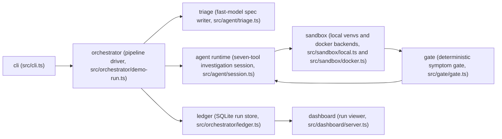

# Reproducer

**Turns bug reports into proof.** Give Reproducer a GitHub issue URL and it returns evidence: a minimal `repro.py`, a citation-backed `findings.md`, and a ledger-backed run trace.

> [!NOTE]
> Under active development. Full product spec: [`.agents/PRDs/PRD.md`](.agents/PRDs/PRD.md).

## Why it exists

Bug reports are claims, not evidence. Reproducer closes that gap: it triages an issue into a machine-checkable symptom spec, researches the error, forms falsifiable root-cause hypotheses, builds clean Python environments, writes and shrinks a minimal reproduction script, verifies the symptom through a deterministic gate, bisects the version where behavior changed, and publishes a report with citations. Every step is persisted to a SQLite ledger and viewable in the dashboard run viewer.

## Quickstart

Prerequisites: Node 22 or newer, [bun](https://bun.sh) 1.4.x, `python3`, and `git`. The replay demos need no API keys and no network.

```sh
git clone https://github.com/techafreshh/reproducer.git
cd reproducer
bun install
npm run typecheck
./bin/reproducer.js run https://github.com/demo/ducklings/issues/1 --replay fixtures/demo-1
npm start &
curl http://localhost:8080/healthz
curl http://localhost:8080/api/runs
```

Expected: typecheck passes, the replay run prints `verdict: reproduced` and exits 0, `/healthz` returns `{"ok":true}`, and `/api/runs` lists the run.

> [!TIP]
> Run the other two keyless demos the same way:
>
> ```sh
> ./bin/reproducer.js run https://github.com/demo/calcbox/issues/2 --replay fixtures/demo-2
> ./bin/reproducer.js run https://github.com/demo/sleepywait/issues/3 --replay fixtures/demo-3
> ```
>
> Each run persists to the SQLite ledger at `data/ledger.db`.

`npm test` runs the unit suite (vitest) and `npm run build` emits `dist/`.

## Usage

### CLI

```
usage: reproducer run <issue-url> [--db <path>] [--post] [--config <path>]
```

| Flag | Effect |
|---|---|
| `--replay <dir>` (or `--replay=<dir>`) | Replay the whole pipeline from a fixture bundle under `fixtures/` — keyless and offline. A bare `--replay` uses the default bundle `fixtures/demo-1`. `REPLAY=1` (also `true`/`yes`) enables the same mode without the flag. |
| `--scripted <dir>` | Run the scripted validation path on one canned fixture (defaults to the built-in demo dir when no dir is given). |
| `--db <path>` | Ledger path. Default: `data/ledger.db`. |
| `--post` | Post the findings as an issue comment. Off by default; only targets in the config allowlist are posted to (anything else exits 3 with `repo not in post allowlist`). |
| `--config <path>` | JSON config file carrying the `post.allowlist` and `dashboardBase` (see Configuration). Without `--post`, `--config` is accepted and ignored. |

Any gate verdict — even non-`reproduced` — still exits 0 on the replay/scripted paths; only bad URLs and unreadable fixtures exit 2 with usage on stdout.

### Dashboard

`npm start` runs `tsx src/dashboard/server.ts`. It listens on `process.env.PORT` when that is a positive integer, otherwise on `8080`. The dashboard is a read-only run viewer over the ledger:

| Route | Purpose |
|---|---|
| `GET /healthz` | Liveness probe, returns `{"ok":true}` |
| `GET /api/runs` | List all runs |
| `GET /api/runs/:id` | One run, with symptom spec and artifact/event summary |
| `GET /api/runs/:id/events` | Per-run tool-call timeline |
| `GET /api/runs/:id/artifacts/:name` | Fetch one artifact (`repro.py`, `findings.md`, …) |
| `/` | Human run viewer — per-run trace renders in-page (click a row) |

Fetch a run's standalone reproduction script and execute it (after running the demos above; demo-3 hangs by design, so bound it with `timeout`):

```sh
curl -sf http://localhost:8080/api/runs/1/artifacts/repro.py -o /tmp/repro-1.py
python3 /tmp/repro-1.py
curl -sf http://localhost:8080/api/runs/3/artifacts/repro.py -o /tmp/repro-3.py
timeout 5 python3 /tmp/repro-3.py; echo "exit: $?"
```

Each run's `findings.md` (`GET /api/runs/:id/artifacts/findings.md`) carries `https://` research citations and a two-row `## Bisect` table (`lastGood` / `firstBad`).

### Docker

```sh
docker compose config
docker compose up --build
```

The compose `worker` service builds from the `Dockerfile` (Node 22 + `python3`/`pip`/`venv`/`git`), maps `8080:8080`, and reads an optional `.env` file.

## Configuration

Copy `.env.example` to `.env` and fill in values only when wiring live providers — replay, tests, and CI need no keys.

| Variable | Purpose |
|---|---|
| `MODEL_PROVIDER` | `openrouter` (default) or `deepseek` (direct fallback) |
| `OPENROUTER_API_KEY` | Key for the OpenRouter live path |
| `DEEPSEEK_API_KEY` | Key for the DeepSeek direct fallback |
| `OPENROUTER_BASE_URL` | Optional override (default `https://openrouter.ai/api/v1`) |
| `DEEPSEEK_BASE_URL` | Optional override (default `https://api.deepseek.com/v1`) |
| `MODEL_FAST` | Fast triage model (single structured `json_schema` call) |
| `MODEL_REASON` | Reasoning model for the investigation session |
| `TINYFISH_API_KEY` | Key for TinyFish Search + Fetch research (citation URLs land in `findings.md`) |
| `GITHUB_TOKEN` | Optional; raises GitHub REST rate limits |
| `REPLAY` | `1`/`true`/`yes` opts into replay mode on the default bundle (`fixtures/demo-1`) |
| `PORT` | Dashboard port when a positive integer, else `8080` |
| `DASHBOARD_BASE_URL` | Overrides the `Trace: <base>/runs/<id>` link in `--post` comments |

`reproducer.config.json` carries the posting allowlist and dashboard base:

```json
{
  "reproducer": {
    "post": { "allowlist": ["techafreshh/reproducer"] },
    "dashboardBase": "http://localhost:8080"
  }
}
```

### Live providers

The live path runs on [OpenRouter](https://openrouter.ai/docs/api-reference/overview) with [DeepSeek](https://api-docs.deepseek.com/) direct as the fallback. `createLiveProvider` in `src/llm/provider.ts` drives triage as a single structured `json_schema` call, so triage output feeds straight into spec validation and freezing. Research runs on [TinyFish Search](https://docs.tinyfish.ai/search-api/reference) with full-text extraction via [TinyFish Fetch](https://docs.tinyfish.ai/fetch-api/reference).

## Architecture

The orchestrator in `src/orchestrator/demo-run.ts` drives the pipeline: triage the issue into a frozen symptom spec, run the investigation session, grade each environment run in the deterministic gate, bisect the version boundary, then persist everything to the ledger for the dashboard run viewer.



- The orchestrator owns the run lifecycle and budget latches; it never calls a model directly.
- The agent runtime (`src/agent/session.ts`) gathers evidence but cannot rewrite the spec.
- The gate grades outcomes with pure code and returns only verdicts to the session.
- The sandbox executes untrusted commands in local venvs or locked-down containers.
- The ledger is the SQLite source of truth every other component reads back.

### Symptom gate

The frozen-verifier pattern separates writing the spec from grading it. Fast-model triage drafts the symptom spec, `freezeSymptomSpec` in `src/gate/spec.ts` validates and latches it once per run, and any later freeze for the same run throws `spec already frozen` — enforced in the gate, the ledger, and SQLite itself. The gate in `src/gate/gate.ts` then computes `reproduced`, `not-reproduced`, or `inconclusive` with zero model calls:

- **Exception class** — the parsed exception type's last dot-segment must equal the class pinned by the spec's error strings (word match when no class is derivable; vacuous when nothing is pinned).
- **Frames** — at least `minMatchingFrames` (default 2) parsed traceback frames must land on the spec's pinned module-plus-function pairs (vacuous when the spec pins no frames).
- **Wrong-output** — every `expectedOutput` entry must appear in stdout after whitespace normalization; a spec with no `expectedOutput` grades `inconclusive`.
- **Hang** — `timedOut` is the verdict: a run that genuinely timed out hung.

When the trigger was never reached the verdict is `inconclusive`: import or module-not-found failures, and `exception` runs that exited 0 without crashing, mean the environment is broken — which says nothing about the bug.

### Security

- **Sanitizer boundary** — `src/sanitize/sanitizer.ts` strips invisible codepoints, normalizes confusable homoglyphs to ASCII, and flags instruction-shaped lines before any untrusted text enters an LLM prompt.
- **Sandbox caps** — local runs get a hard timeout (SIGKILL) plus CPU and filesize rlimits; container runs are locked to `docker run --rm --network none --memory 512m --cpus 1 --pids-limit 128`, relaxed only for dependency installs, and the sandbox environment is scrubbed of secrets.
- **Budget latches** — `src/orchestrator/budgets.ts` caps each run at 3 hypotheses, 8 environment runs per hypothesis, a 20-minute wall clock, and a 100k-token ceiling; overruns end the run as `inconclusive`.
- **No-post default with allowlist** — issue comments are off unless `--post` is passed AND the target matches the case-insensitive `owner/repo` allowlist (default `techafreshh/reproducer` in `reproducer.config.json`).
- **Secrets in `.env` only** — keys live in a local `.env` file, never in code, logs, or the sandbox.

## Limitations

- **Python and PyPI only** — no JS, Go, or Rust ecosystems.
- **No native dependencies** — pure-Python wheels and sdists only, no C extensions.
- **No auto-fix PRs** — the agent writes a fix sketch in `findings.md` at most, never the library fix itself.
- **No GUI, hardware, or networked-service bugs.**
- **No parallel issue batching, team features, or SSO.**
- **No posting outside the allowlist** — `--post` to a non-allowlisted repo exits 3 before any run or network post.

### Roadmap

- Multi-ecosystem support (JS/Go/Rust).
- Native/C-extension dependency handling.
- Live-provider walkthrough with real API keys (replay covers keyless use today).

---

MIT — see [LICENSE](LICENSE).
