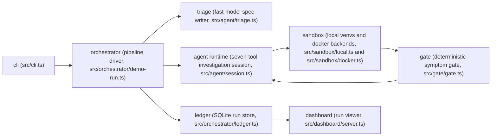

# Reproducer

**Turns bug reports into proof.**

Reproducer takes a GitHub issue URL and returns evidence: it triages the report into a machine-checkable symptom spec, researches the error, forms falsifiable root-cause hypotheses, builds clean Python environments, writes and shrinks a minimal reproduction script, verifies the reported symptom through a deterministic gate, bisects the exact version where behavior changed, and publishes a citation-backed report.

> Under active development for the Nebius x NVIDIA Global AI Hackathon (Devpost) — Coding and Agentic Engineering track. Full product spec: [`.agents/PRDs/PRD.md`](.agents/PRDs/PRD.md).

## Setup

Fresh clone to a green acceptance pass in nine steps. The replay demos need
no API keys and no network.

1. Clone the repository and move into it.
2. Install dependencies with `bun install` (requires Node 22 or newer and bun 1.4.x).
3. Run the strict type gate with `npm run typecheck`.
4. Run the three keyless replay demos — each exits 0 and ends with its
   `expected.json` status (`reproduced`). The URLs below are the `url` fields
   of `fixtures/demo-N/expected.json`; runs persist to the SQLite ledger at
   `data/ledger.db` (override with `--db <path>`).

   ```sh
   ./bin/reproducer.js run https://github.com/demo/ducklings/issues/1 --replay fixtures/demo-1
   ./bin/reproducer.js run https://github.com/demo/calcbox/issues/2 --replay fixtures/demo-2
   ./bin/reproducer.js run https://github.com/demo/sleepywait/issues/3 --replay fixtures/demo-3
   ```

5. Start the service and dashboard with `npm start` (listens on `PORT`, default 8080).
6. Confirm the service is up with `curl http://localhost:8080/healthz` (expect 200 and `{"ok":true}`).
7. Confirm the dashboard sees exactly the three runs, and that an unknown run 404s:

   ```sh
   curl http://localhost:8080/api/runs
   curl -o /dev/null -w '%{http_code}\n' http://localhost:8080/api/runs/999
   ```

   Each run's trace renders at `/runs/:id` in the dashboard (runs list +
   per-run tool-call timeline + artifact viewer), backed by
   `GET /api/runs/:id/events` and `GET /api/runs/:id/artifacts/:name`.
8. Fetch each run's standalone `repro.py` and execute it: demo-1 exits nonzero
   with `ValueError` in stderr, demo-2 exits nonzero with `AssertionError` in
   stderr, demo-3 hangs by design so bound it with `timeout`:

   ```sh
   curl -sf http://localhost:8080/api/runs/1/artifacts/repro.py -o /tmp/repro-1.py
   python3 /tmp/repro-1.py
   curl -sf http://localhost:8080/api/runs/2/artifacts/repro.py -o /tmp/repro-2.py
   python3 /tmp/repro-2.py
   curl -sf http://localhost:8080/api/runs/3/artifacts/repro.py -o /tmp/repro-3.py
   timeout 5 python3 /tmp/repro-3.py; echo "exit: $?"
   ```

   Each run's `findings.md` (`GET /api/runs/:id/artifacts/findings.md`)
   carries `https://` research citations and a two-row `## Bisect` table
   (`lastGood` / `firstBad`).
9. Validate the compose surface, then bring the stack up:

   ```sh
   docker compose config
   docker compose up --build
   ```

```sh
git clone https://github.com/techafreshh/reproducer.git
cd reproducer
bun install
npm run typecheck
./bin/reproducer.js run https://github.com/demo/ducklings/issues/1 --replay fixtures/demo-1
npm start &
curl http://localhost:8080/healthz
curl http://localhost:8080/api/runs
```

`npm test` runs the unit suite and `npm run build` emits `dist/`. Live providers stay off unless you opt in (see Security).

## Architecture

The pipeline is driven by the orchestrator in `src/orchestrator/demo-run.ts`: triage the issue into a frozen symptom spec, run the investigation session, grade each environment run in the deterministic gate, bisect the version boundary, then persist everything to the ledger for the dashboard run viewer.



- The orchestrator owns the run lifecycle and budget latches; it never calls a model directly.
- The agent runtime is a seven-tool investigation session (`src/agent/session.ts`) that gathers evidence but cannot rewrite the spec.
- The gate grades outcomes with pure code and returns only verdicts to the session.
- The sandbox executes untrusted commands in local venvs (`src/sandbox/local.ts`) or locked-down containers (`src/sandbox/docker.ts`).
- The ledger is the SQLite source of truth every other component reads back.
- The dashboard is a read-only run viewer over the ledger (`GET /healthz`, `GET /api/runs`).

## Symptom Gate

The frozen-verifier pattern separates writing the spec from grading it. Fast-model triage in `src/agent/triage.ts` (via the provider in `src/llm/provider.ts`) drafts the symptom spec, `freezeSymptomSpec` in `src/gate/spec.ts` validates and latches it once per run, and any later freeze for the same run throws `spec already frozen` — enforced in the gate, the ledger, and SQLite itself. The investigation session in `src/agent/session.ts` has no spec-mutating tool, so it can only produce evidence; the gate in `src/gate/gate.ts` then computes `reproduced`, `not-reproduced`, or `inconclusive` with zero model calls.

The deterministic gate applies one rule set per symptom class:

- **Exception class** — the parsed exception type's last dot-segment must equal the class pinned by the spec's error strings (word match when no class is derivable; vacuous when nothing is pinned).
- **Frames** — at least `minMatchingFrames` (default 2) parsed traceback frames must land on the spec's pinned module-plus-function pairs (vacuous when the spec pins no frames).
- **Wrong-output** — every `expectedOutput` entry (the text a buggy run emits) must appear in stdout after whitespace normalization; a spec with no `expectedOutput` grades `inconclusive` instead of fabricating output.
- **Hang** — `timedOut` is the verdict: a run that genuinely timed out hung, even if it logged import noise first.

When the trigger was never reached the verdict is `inconclusive`: import or module-not-found failures, and `exception` runs that exited 0 without crashing, mean the environment is broken — which says nothing about the bug.

## Scope (v1)

Stated loudly, sourced from the PRD's Out of Scope section:

- **Python and PyPI only** — no JS, Go, or Rust ecosystems.
- **No native dependencies** — pure-Python wheels and sdists only, no C extensions.
- **No auto-fix PRs** — the agent writes a fix sketch in `findings.md` at most, never the library fix itself.
- **No GUI, hardware, or networked-service bugs** — no GUI apps, hardware faults, or networked-service failures.

## Security

- **Sanitizer boundary** — `src/sanitize/sanitizer.ts` strips invisible codepoints, normalizes confusable homoglyphs to ASCII, and flags instruction-shaped lines before any untrusted text enters an LLM prompt.
- **Sandbox caps** — local runs get a hard timeout (SIGKILL) plus CPU and filesize rlimits (`src/sandbox/local.ts`); container runs are locked to `docker run --rm --network none --memory 512m --cpus 1 --pids-limit 128` (`src/sandbox/docker.ts`), relaxed only for dependency installs, and the sandbox environment is scrubbed of secrets so runs never see keys.
- **Budget latches** — constants in `src/orchestrator/budgets.ts` cap each run at 3 hypotheses, 8 environment runs per hypothesis, a 20-minute wall clock, and a token ceiling; overruns end the run as `inconclusive` instead of spending more.
- **No-post default with allowlist** — issue comments are off unless `--post` is passed AND the target matches the case-insensitive `owner/repo` allowlist (`src/post/config.ts`, default `techafreshh/reproducer` in `reproducer.config.json`).
- **Secrets in `.env` only** — keys live in a local `.env` file, never in code, logs, or the sandbox; copy `.env.example` to `.env` and fill in values only when wiring live providers.

```env
NEBIUS_BASE_URL=https://api.tokenfactory.nebius.com/v1
NEBIUS_API_KEY=
MODEL_FAST=
MODEL_REASON=
TINYFISH_API_KEY=
GITHUB_TOKEN=
REPLAY=0
```

## Nebius / NVIDIA Tools Feedback

We built the live path on the Nebius Token Factory: `NEBIUS_BASE_URL` plus `MODEL_FAST` and `MODEL_REASON` from `.env.example` select the fast triage model and the reasoning session model, and `createLiveProvider` in `src/llm/provider.ts` drives triage as a single structured `json_schema` call. Trying Nemotron-family models through that path was smooth — the schema-constrained call returns a spec-shaped object on the first attempt far more often than free-form JSON, which matters because triage output feeds straight into spec validation and freezing. The scripted driver versus live driver split paid off during development: scripted sessions reproduce the full pipeline deterministically for tests and demos, while flipping to the live provider exercises the same tool surface against real models with no code change. Fixture and replay ergonomics are the standout: bundled fixtures under `fixtures/` plus the replay toggle turn a cold clone into a passing end-to-end run with no keys, which is exactly the loop a judge or new contributor needs.
